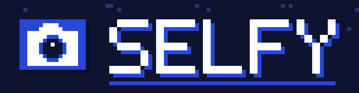

<p align="center">
  
</p>

<p align="center">
  <b>Cloudflare で動く、自分と仲間のための写真ストレージ</b>
</p>

<p align="center">
  日本語 | <a href="README.en.md">English</a>
</p>

---

## Selfy とは

Selfy は、自分の Cloudflare アカウントで動かすセルフホスト型の写真ストレージ兼ビューワーです。
家族や友人など、少人数で写真を持ち寄って眺めるための使い方を想定しています。

[Void](https://void.cloud) (Cloudflare Workers 向けのフルスタック Vite フレームワーク) で作られていて、
写真は R2、データは D1 に保存されます。

## 主な機能

- 📁 **アルバム** — アルバムごとに写真を整理。HEIC は自動で変換し、撮影日時は EXIF から読み取ります
- 🖼️ **ライトボックス** — 写真の拡大表示とキーボード・スワイプでの移動
- ⭐ **お気に入り** — 気に入った写真をまとめて表示
- ✅ **一括操作** — ドラッグでまとめて選択し、ダウンロード (ZIP)・非表示・削除
- 👥 **メンバー共有** — アルバムに「閲覧」または「投稿」できるメンバーを追加
- 🔗 **共有リンク** — ログイン不要で見られるリンクを発行 (期限とダウンロード可否を設定可)
- 🔐 **パスワードなしのログイン** — パスキー、メールのログインリンク、確認コード
- 🛡️ **招待制** — 管理者が許可したメールアドレスだけが登録・ログインできます
- 🌗 **ダークモードとスマホ対応**

## セルフホスト

自分の Cloudflare アカウントに Selfy をデプロイする手順です。

### 必要なもの

- Cloudflare アカウント (D1・R2・Workers を使います)
- Cloudflare で管理しているドメイン (アプリの URL に使います)
- [Resend](https://resend.com) のアカウントと、送信元として認証済みのドメイン
- [Bun](https://bun.sh)

### 1. リポジトリを用意する

```sh
git clone https://github.com/kazeusagi/selfy.git
cd selfy
bun install
```

### 2. Cloudflare にログインする

```sh
bunx void cloudflare login
```

ブラウザが開くので、デプロイ先のアカウントを選んでください。

### 3. シークレットを設定する

本番用の値は `.env` からはアップロードされません。`void secret put` で設定します。

```sh
bunx void secret put RESEND_API_KEY   # Resend の API キー
bunx void secret put ADMIN_EMAIL      # 管理者のメールアドレス
bunx void secret put EMAIL_FROM       # メールの送信元アドレス (Resend で認証したドメインのもの)
```

`BETTER_AUTH_SECRET` は Void が自動で作成するので、設定は不要です。

> [!NOTE]
> まだ Worker が存在しないためにシークレットを設定できない場合は、先に一度 `void deploy` を実行してから設定し、もう一度デプロイしてください。

### 4. デプロイする

公開するドメインは環境変数 `SELFY_DOMAIN` で指定します。Cloudflare で管理しているドメインを使ってください。

```sh
SELFY_DOMAIN=photos.example.com bunx void deploy --platform cloudflare
```

`SELFY_DOMAIN` を指定しなければ、独自ドメインは使わず `*.workers.dev` のサブドメインで公開されます。

```sh
bunx void deploy --platform cloudflare
```

> [!WARNING]
> `SELFY_DOMAIN` は `.env` ではなく、デプロイするコマンドの環境変数として渡してください。
> 独自ドメインで公開したあとに指定し忘れてデプロイすると、独自ドメインが外れて `*.workers.dev` に切り替わります。

D1・R2 の作成、ビルド、マイグレーションの適用、Worker のアップロードまでまとめて行われます。
作成したリソースの ID は `void.lock.json` に記録されます。このファイルは環境ごとに異なるため `.gitignore` に入れてあります。
消してしまうと次のデプロイでリソースが新しく作られてしまうので、手元で大切に保管してください。

### 5. 使い始める

1. 設定したドメインを開き、`ADMIN_EMAIL` のアドレスでログインします。
2. ほかの人に使ってもらうには、**設定** 画面からメールアドレスを許可リストに追加します。
   許可されていないアドレスは登録もログインもできません。
3. 追加した人が一度ログインすると、アルバムのメンバー候補に表示されるようになります。

### GitHub Actions で自動デプロイする (任意)

`.github/workflows/void-deploy.yml` に、push 時にデプロイするワークフローが入っています。
現在はデプロイ対象のブランチを存在しない名前にして無効にしてあるので、使う場合は `branches` をデプロイしたいブランチに変更してください。

`void.lock.json` はリポジトリに含まれないため、CI から使う場合は自分のフォークで `.gitignore` から外してコミットしてください。
独自ドメインで公開する場合は、リポジトリの Variables に `SELFY_DOMAIN` を登録してください。
また、リポジトリの Secrets に `CLOUDFLARE_API_TOKEN` (Workers Scripts の編集権限と、D1・R2 へのアクセス権を持つトークン) を登録する必要があります。
詳しくは [Void のドキュメント](https://void.cloud) を参照してください。

## 開発環境の起動

### 技術スタック

| 分類 | 使っているもの |
|---|---|
| フレームワーク | [Void](https://void.cloud) / Vite / React |
| 実行環境 | Cloudflare Workers |
| データベース | Cloudflare D1 (Drizzle) |
| ストレージ | Cloudflare R2 |
| 認証 | Better Auth (パスキー・マジックリンク・メール OTP) |
| メール送信 | [Resend](https://resend.com) |
| UI | Tailwind CSS / shadcn/ui / Radix UI |

### 必要なもの

- [Bun](https://bun.sh)

### 手順

1. 依存パッケージをインストールします。

   ```sh
   bun install
   ```

2. `.env.example` をコピーして `.env` を作り、`ADMIN_EMAIL` を自分のメールアドレスに書き換えます。
   開発中のメールはローカルの受信箱に届くので、ほかの値はそのままで構いません。

   ```sh
   cp .env.example .env
   ```

3. 開発サーバーを起動します。データベースのマイグレーションは起動時に自動で適用されます。

   ```sh
   bun run dev
   ```

4. <http://localhost:5173> を開き、`ADMIN_EMAIL` に設定したアドレスでログインします。
   ログイン用のメールは実際には送られず、起動時にターミナルに表示される
   `http://localhost:5173/__void/inbox?token=...` の受信箱に届きます。

### よく使うコマンド

| コマンド | 内容 |
|---|---|
| `bun run dev` | 開発サーバーを起動 |
| `bun run build` | 本番用にビルド |
| `bunx void db generate` | `src/db/schema.ts` の変更からマイグレーションを生成 |

## ライセンス

[MIT](LICENSE)
